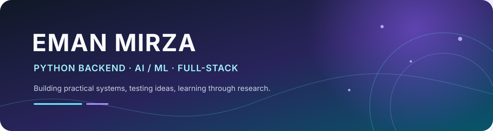
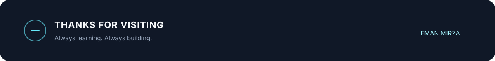

  
  
  

## Hey, I'm Eman.

**Python Backend Developer working on AI-powered applications and machine learning projects.**

I enjoy building practical software, from backend APIs and data workflows to AI agents and ML experiments. I like understanding how systems work, testing ideas, and improving them through hands-on projects.

- **Main focus:** Python, FastAPI, backend engineering
- **Exploring:** Machine learning, LLM applications, agent workflows
- **Also work with:** React, Next.js, PostgreSQL and modern web tooling
- **Currently learning:** Model evaluation, reliable AI systems, and Rust/Solana

## What I'm building

<table>
<tr>
<td width="50%" valign="top">

### [PATCH-LOOP](https://github.com/Eman2123/PATCH-LOOP)
**AI tooling · Sandboxed execution**

Exploring isolated code execution for AI-assisted developer workflows, with a focus on tool boundaries and safer execution.

</td>
<td width="50%" valign="top">

### [Campus AI](https://github.com/Eman2123/Campus-AI)
**FastAPI · Next.js · AI**

A university assistant project bringing together document question-answering, scheduling, and student support workflows.

</td>
</tr>
<tr>
<td width="50%" valign="top">

### [ClerkifyDx](https://github.com/Eman2123/ClerkifyDx)
**AI-assisted clinical intake**

A prototype for structured patient intake, follow-up questions, and rule-based red-flag checks before clinician review.

[Demo video](https://youtu.be/5bS7hfpExYU)

</td>
<td width="50%" valign="top">

### [VendorPulse](https://github.com/Eman2123/VendorPlus)
**Backend systems · Workflow automation**

A supplier follow-up platform that collects updates, tracks deadlines, and flags potential delivery risks.

[Live demo](https://vendorplus.fastapicloud.dev)

</td>
</tr>
<tr>
<td width="50%" valign="top">

### [TinyAya experiments](https://github.com/Eman2123/tinyaya-idk)
**Machine learning · Model behavior**

An ML-focused project exploring model uncertainty and when a system should abstain rather than return an unreliable answer.

[Hugging Face](https://huggingface.co/EmanMirza2025)

</td>
<td width="50%" valign="top">

### [EchoMind](https://github.com/Eman2123/EchoMind)
**Voice AI · AssemblyAI**

An experiment in voice interaction and memory-oriented AI workflows.

[Live demo](https://echo-mind-trfi.vercel.app/)

</td>
</tr>
</table>

[Explore all repositories →](https://github.com/Eman2123?tab=repositories)

## Tools I use

  
   
  
   
  

**AI / ML:** Hugging Face, LangChain, LangGraph, LLM integrations

## A little more

I started with web development and gradually moved deeper into backend engineering and AI. Hackathons and independent projects have given me opportunities to work with unfamiliar tools, build under constraints, and learn by shipping.

My goal is to become a stronger engineer by building systems that are useful, understandable, and dependable.

## Find me online

  <a href="https://eman-portfolio-iota.vercel.app/">Portfolio</a> ·
  <a href="https://www.linkedin.com/in/eman-mirza-926035249/">LinkedIn</a> ·
  <a href="https://huggingface.co/EmanMirza2025">Hugging Face</a> ·
  <a href="https://github.com/Eman2123">GitHub</a>

  
    
  

